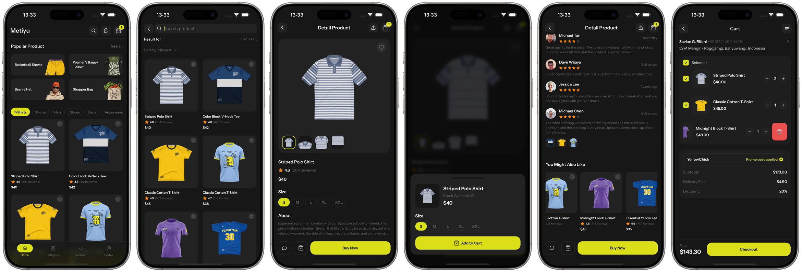

# Metiyu

A dark, editorial online-store app for iOS and Android, built from a Figma design with Expo and React Native. Browse, search, view a product, pick a size, add to cart, apply a promo and pay — every screen of the design, with motion that feels native on both platforms.



**▶ [Watch the 50-second walkthrough](docs/demo.mp4)** (recorded on iPhone)

Expo SDK 56 · React Native 0.85 · React 19 + React Compiler · Expo Router · Reanimated 4 · NativeWind 4 · TypeScript

---

## What's in it

| Flow | Screens |
| --- | --- |
| Browse | Home (popular products, category chips, product grid), Category list → category detail |
| Find | Search with live filtering, result count and a sort sheet (newest, trending, price, rating) |
| Product | Image gallery with angle thumbnails, sizes, description, reviews, "You might also like", a buy sheet with stock |
| Buy | Cart with per-item select, quantity steppers, swipe to delete, promo code, delivery fee and totals; payment method sheet |
| After | Orders list → order detail with a review sheet; chat with the seller (product bubble, keyboard-aware input); profile |

Data is local (`src/data`) so the app runs with no backend; screens only read from those modules, so swapping in an API is a change in one place.

## Things worth looking at

**Native-feeling navigation on both platforms**
- `src/lib/navigation.ts` picks the stack animation per platform: native slides on iOS, a cross-fade on Android, where slide transitions can flash a blank frame while the next screen paints.
- The navigators get a dark React Navigation theme matching the app background, so back gestures never flash white behind the screen.
- Tabs that host a nested stack (Category, Orders) reset to their list on tab press instead of reopening the last detail screen.

**Motion on the UI thread**
- All animation uses Reanimated shared values and `useAnimatedStyle`, so it runs on the UI thread and doesn't drop frames when JavaScript is busy.
- `PressableScale` is a drop-in `Pressable` that eases the element down while held, giving every tappable card and button the same tactile response.
- Search results fade and rise into place the first time they scroll into view, driven by `FlatList`'s `onViewableItemsChanged` and latched so they don't replay.
- The buy, payment and review sheets animate their backdrop and panel from one Reanimated progress value, so both stay in sync when opening and closing.
- Cart rows use `ReanimatedSwipeable`: a full swipe deletes, and the revealed button is the explicit alternative.
- The "Added to cart" toast slides in and dismisses itself; the cart badge zooms in when the count first appears.

**Platform differences handled, not ignored**
- The tab bar is a blurred, brand-tinted overlay. iOS blurs natively; Android, where a live blur behind an overlay isn't practical, falls back to the gradient tint so it still reads correctly.
- Safe-area insets size the tab bar and screens, so it fits notched iPhones and gesture-nav Android phones alike.

**A small, consistent UI kit**
- Colour tokens come from the Figma file and live in one place: Tailwind config for `className`, mirrored in `src/theme/colors.ts` for native APIs that only take values (tab tint, status bar, icons).
- `AppImage` wraps `expo-image` (cached, decoded off the JS thread) with NativeWind `className` support; `AppText` applies the Instrument Sans weights.
- Shared `Chips`, `IconButton`, `Header`, `Screen` and `Container` keep spacing and type identical across screens.

**Cart logic**
- `src/lib/cart.tsx` keys items by product + size, so the same shirt in M and L are separate lines. Selection drives totals, and the promo discount and delivery fee are applied to selected items only.

**Tooling**
- The React Compiler is enabled (`experiments.reactCompiler`), so components are memoized automatically instead of by hand.
- `patches/` carries a `patch-package` fix for `react-native-css-interop`, whose Metro file-change event didn't match the new Metro API and could crash the dev server.

## Project structure

```
app/                  Expo Router routes
  (tabs)/             Home, Category (stack), Orders (stack), Profile
  product/[id].tsx    Product detail
  search.tsx  cart.tsx  chat.tsx  reviews.tsx  orders/[id].tsx
src/
  components/         UI kit (ui/, layout/, icons/) and feature components
  data/               Products, categories, orders, reviews
  lib/                Cart state, navigation helpers
  theme/              Colour tokens
```

## Run it

```bash
npm install
npx expo start        # then press i for iOS Simulator or a for Android
```

## Credits

Design: "Metiyu – Online Store Mobile App" (Figma). Typeface: Instrument Sans (Google Fonts). Built by [@okoliken](https://github.com/okoliken).
